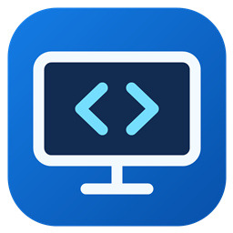

# Aspect Switch

An independent Windows tray utility for per-input aspect-ratio automation on compatible DDC/CI monitors, regardless of brand. Multiple PCs and consoles, monitor discovery, and learned scaling profiles. No manufacturer software required.

PC, Switch, PlayStation, Xbox 등을 번갈아 사용할 때 입력별 화면 비율을 자동으로 맞춥니다. WinUI 3로 구현한 Windows 11 다크 모드 설정 화면에서 기기의 이름·입력·비율을 지정합니다.



## 시작하기

1. [Releases](https://github.com/i0rph/aspect-switch/releases/latest)의 `Aspect-Switch-1.0.0-win-x64.zip`을 쓰기 가능한 폴더에 풉니다.
2. `AspectSwitch.exe`를 실행합니다.
3. **모니터 호환성 → 모니터 검색 → 선택한 모니터 사용**을 누릅니다.
4. **기기와 화면 → 기기 추가**에서 이름, 입력, 적용할 비율을 지정합니다. 카드 상단에서 PC·콘솔 이름을 선택하거나 **직접 입력**으로 원하는 이름을 적습니다.
5. **변경 사항 저장**을 누릅니다. 재시작 없이 반영됩니다.

트레이 아이콘을 더블클릭하면 설정을 엽니다. 우클릭 메뉴에서 등록된 모든 기기로 수동 전환하거나 자동 적용을 일시정지할 수 있습니다.

## 지원 범위

| 구분 | 지원 방식 / 검증 수준 |
| --- | --- |
| AOC AGP346UCSD | 모델별 비율 프리셋 내장. 실제 DP PC ↔ HDMI 2 Switch에서 전체 화면 / 원본 비율 전환 검증 |
| 다른 브랜드 / 모델 | 브랜드 제한 없이 탐색. 고유하게 식별되며 DDC/CI 현재 입력(0x60)·화면 비율(0x86) 조회에 성공하면 사용자 프로필 등록 가능 |
| 알 수 없는 비율 이름 | OSD에서 선택한 현재 값을 읽어 이름과 함께 등록. AGP346UCSD 전용 값을 다른 모델에 적용하지 않음 |
| DDC/CI 비율 읽기 미지원 | 검색 결과가 있어도 자동 제어용 설정을 차단. 전용 USB/HID·제조사 확장 프로토콜은 아직 구현하지 않음 |

**DDC/CI 지원만으로 화면 비율 자동화까지 보장되지는 않습니다.** 등록 시 입력·비율 조회 성공 여부를 확인하며, 실제 비율 변경 및 콘솔 입력에서의 PC 통신 유지 여부는 모델별 확인이 필요합니다. 밝기만 제어되거나 비율 조회를 지원하지 않는 모니터는 등록할 수 없습니다. 제조사 전용 명령·주소를 요구하는 모델은 현재 지원하지 않습니다. 브랜드별 모의 테스트는 실제 모델의 호환성 검증이 아닙니다.

- Windows 11 x64 / .NET Framework 4.8. WinUI 3 UI는 .NET 8 및 Windows App SDK 런타임을 배포 폴더에 포함합니다. 실행에 별도 SDK, Python, G-Menu가 필요하지 않습니다.
- 실제 시스템 Mica, 기본 창 버튼과 Snap Layout, Fluent 입력 컨트롤을 사용합니다. Mica는 배경화면의 색감을 반영하는 재질이며 뒤쪽 창이 그대로 비치는 유리 효과는 아닙니다. Windows 투명 효과·절전 정책에 따라 단색으로 표시될 수 있습니다.
- PC가 켜져 있고 영상 케이블로 연결돼 있어야 합니다. 모니터 OSD의 **DDC/CI**를 켜세요.
- Windows DDC/CI API를 사용합니다. USB 케이블만 연결된 모니터는 제어하지 않습니다.
- 콘솔 입력에서도 PC 쪽 DDC 통신이 유지돼야 합니다. 비활성 입력의 DDC를 차단하는 모니터에서는 자동 전환이 제한됩니다.
- 한 번에 **선택한 모니터 한 대**를 제어합니다. 같은 모델 여러 대는 Windows 장치 경로로 구별하며 대응 관계가 모호하면 쓰지 않습니다. 포트나 도킹 구성이 바뀌면 모니터를 다시 선택해야 할 수 있습니다.
- 모니터 한 대에 입력별 기기를 여러 개 등록합니다. 입력당 한 기기이며 사용 가능한 입력 수를 넘겨 추가할 수 없습니다. 저장 형식의 상한은 64개입니다.
- HDMI 선택기 뒤의 여러 콘솔은 모니터에서 같은 입력으로 보이므로 개별 자동 식별이 불가능합니다.
- 읽기 성공은 쓰기 동작까지의 검증을 뜻하지 않습니다. 새 모델은 각 입력으로 전환해 실제 화면 비율도 확인하세요.

이 프로젝트는 모니터 제조사와 무관한 독립 소프트웨어입니다. 제조사 실행 파일, DLL, 역컴파일 결과는 포함하지 않습니다.

## 다른 모델에서 화면 비율 등록하기

1. **모니터 호환성**에서 대상 모니터를 선택합니다.
2. 모니터 OSD에서 PC에 쓸 비율을 선택합니다.
3. **OSD에서 선택한 비율 등록**에 `전체 화면` 등 이름을 입력하고 **현재 비율 등록**을 누릅니다.
4. OSD에서 콘솔용 비율을 선택하고 `원본 비율` 등 다른 이름으로 등록합니다.
5. **기기와 화면**에서 각 기기에 등록한 비율을 지정하고 저장합니다.

설정 창이 열린 동안 자동 적용은 잠시 멈춥니다. 등록은 현재 값을 읽는 작업이며 실제 비율은 OSD에서 선택합니다. 같은 값을 다시 등록하면 이름을 수정합니다. 입력 지원 정보가 없는 펌웨어에서는 현재 읽은 포트만 처음 표시됩니다. OSD로 다른 입력을 선택하고 현재 비율을 등록하면 그 입력도 추가됩니다.

표준 이름으로 식별할 수 없는 입력은 값으로 표시합니다. 다른 모니터를 선택하면 초안의 기기 목록을 새로 구성하며 저장 전에는 기존 설정에 반영되지 않습니다.

## 일반 설정

- **자동 화면 비율 적용**: 일시정지 / 재개. 개별 기기의 사용 스위치도 제공됩니다.
- **Windows 로그인 시 시작**: 현재 사용자 계정의 시작 프로그램 등록 / 해제.
- **입력 확인 간격**: 1~10초, 기본 2초. 두 번 같은 입력을 읽은 뒤 변경합니다.
- 등록되지 않거나 사용을 끈 기기의 비율은 변경하지 않습니다. 자동 적용 중에는 수동 OSD 변경도 등록된 비율로 되돌릴 수 있습니다.
- 실기 검증 환경의 반영 시간은 대략 5~10초이며 재연결이나 읽기 실패 시 더 걸릴 수 있습니다.

## 등록 해제와 앱 초기화

- **모니터 호환성 → 모니터 등록 해제…**: 모니터와 그에 연결된 기기·입력·비율 프로필을 초안에서 제거합니다. **변경 사항 저장**을 눌러야 적용되며 일반 설정과 자동 시작은 유지합니다.
- **일반 → 데이터 관리 → 앱 초기화…**: 확인 후 즉시 적용됩니다. 모니터·기기·프로필·일반 설정, `settings.json`과 `settings.json.*` 백업/임시 파일, `data/events.log`와 `.1`, `status.json`, `discovery.json`, UI 오류 기록을 삭제하고 Windows 자동 시작을 해제합니다. 초기 설정 화면이 다시 열립니다. 프로그램 파일과 다른 파일은 지우지 않습니다.
- 검색은 이미 등록된 모니터도 표시하며 기기 목록을 바꾸지 않습니다. 검색 결과 0개는 연결 안내로 표시합니다. 테스트/미리보기 창은 실제 사용용이 아니므로 `AspectSwitch.exe --settings`에서 설정을 여세요.

## 설정 이전과 업그레이드

`settings.json`에 모니터 식별 정보, 입력·비율 목록, `Devices` 배열을 저장합니다. [빈 설정 예시](settings.example.json)와 [기기 4개 예시](examples/multi-device.json)를 참고하세요. 프로필 값은 모델마다 다르므로 예시를 다른 모델에 그대로 적용하지 마세요.

이전 개발 빌드의 `PcInput`, `SwitchInput` 또는 `ConsoleInput`, 비율, 확인 간격, 자동 적용 상태를 스키마 3 기기 목록으로 이전합니다. 다음 저장부터 새 형식으로 저장합니다. 기존 프로필의 모니터가 유일하면 이름으로 사용할 수 있고 모니터를 다시 선택하면 장치 경로도 연결합니다.

업데이트할 때 종료 후 실행 파일, `.exe.config`, **`ui-runtime` 폴더 전체**를 교체하고 **기존 `settings.json`을 보존**하세요. 폴더를 옮기면 자동 시작을 껐다가 새 위치에서 켜세요. JSON 직접 편집은 프로그램을 종료한 상태에서 합니다.

로그는 `data/events.log`에 기록하며 1MB 초과 시 직전 로그 하나를 보관합니다. 설정·로그·실행 파일·빌드 결과는 Git에서 제외됩니다. 개인 설정에 장치 식별 경로가 있으므로 문제 보고 시 필요한 부분만 공유하세요.

## 빌드 / 테스트

Windows 기본 .NET Framework C# 컴파일러(트레이)와 .NET 8 SDK / Windows SDK(WinUI 설정)가 필요합니다. Windows App SDK 버전과 NuGet 잠금 파일을 고정하며 첫 빌드 시 패키지를 복원합니다. 배포 ZIP에는 실행에 필요한 런타임이 포함됩니다.

```powershell
powershell -NoProfile -ExecutionPolicy Bypass -File .\build.ps1 -Test -Package
```

- 실행 파일: `bin/Release/AspectSwitch.exe` 및 `bin/Release/ui-runtime/`
- SDK 경로 지정: `-DotNetPath C:\path\to\dotnet.exe`
- 로컬 데스크톱에서 WinUI 검증: 위 명령에 `-UiSmoke` 추가. GitHub Actions에서는 빌드와 기존 규칙 검사를 실행합니다.
- ZIP과 SHA-256: `dist/`
- 테스트: 설정 이전, 다중 기기 규칙, 지원 정보 파싱, 프로필 분리·학습, 원자적 저장, 재시도, 설정 UI 흐름, 최소 크기와 확대 레이아웃.
- 테스트에서는 실제 모니터 명령을 보내지 않습니다. 가상 모델 테스트는 실기 지원을 의미하지 않습니다.

모니터 명령 없이 새 UI를 확인합니다. 미리보기의 저장은 검증만 수행하며 실제 설정을 바꾸지 않습니다.

```powershell
Start-Process .\bin\Release\ui-runtime\AspectSwitch.Settings.exe -ArgumentList '--preview'
# --page devices / compatibility / general
```

WinUI 화면/입력/기기 추가/중복 검증은 `-UiSmoke`에서 확인합니다. `--render <png>`는 문서용 XAML 클라이언트 렌더이며 OS Mica와 제목 표시줄 합성은 포함하지 않습니다. 실제 창의 스크린샷으로 외관을 확인하세요.

## 진단 / 동작 원리

```powershell
Start-Process .\AspectSwitch.exe -ArgumentList '--discover --out discovery.json' -Wait
Start-Process .\AspectSwitch.exe -ArgumentList '--status --out status.json' -Wait
Get-Content .\status.json
Start-Process .\AspectSwitch.exe -ArgumentList '--settings'
Start-Process .\AspectSwitch.exe -ArgumentList '--stop' -Wait
```

자동화는 0x60을 읽고 등록된 입력이면 0x86 값을 비교합니다. 같은 입력을 두 번 확인하고 쓰기 직전 입력과 설정 리비전을 다시 검사합니다. 스케일러 재연결로 핸들이 무효화될 수 있어 다음 읽기는 별도 프로세스·새 핸들로 수행합니다. 읽기 실패는 입력 변경으로 취급하지 않습니다. 재시도 간격은 10초이고 같은 입력에서 3회 실패하면 중단합니다. 자동 적용을 껐다 켜거나 입력을 바꾸면 다시 시도합니다.

`--discover`는 장치 식별 결과이며 지원 여부까지 검사한 결과는 아닙니다. UI에서 선택할 때 현재 입력·비율과 capability string을 읽어 확인합니다. 검색과 비율 등록은 읽기만 수행합니다.

## 릴리스

[공개 저장소](https://github.com/i0rph/aspect-switch) · [실행 파일 다운로드](https://github.com/i0rph/aspect-switch/releases/latest)

Push/PR마다 GitHub Actions가 Windows에서 빌드·테스트하고 배포 파일을 artifact로 보관합니다. `VERSION`과 일치하는 태그는 **초안 릴리스**를 생성합니다. 빌드 결과를 확인한 뒤 게시합니다.

```powershell
git tag v1.0.0
git push origin v1.0.0
```

## 개발 구조

- `Settings.cs`: 스키마 3, 브랜드와 무관한 다중 기기 규칙, 이전·검증·원자적 저장
- `Compatibility.cs`: 실제 입력·비율 조회 및 고유 식별 여부 검사, capability string 파싱, 프로필 생성과 OSD 학습
- `MonitorControl.cs`: 물리 모니터 탐색·식별·DDC/CI 읽기·쓰기
- `ui/`: 실제 WinUI 3 설정 창, Mica, 시스템 제목 표시줄, 공유 설정 모델
- `SettingsWindowSession.cs`: 트레이 ↔ WinUI 초안/저장 응답, 세션 검증
- `SettingsForm.cs`: 이전 WinForms UI 회귀 검사용 (실행 경로에서는 사용하지 않음)
- `Theme.cs`: 트레이 아이콘 및 이전 UI 테스트 리소스
- `Policy.cs`: 안정화 확인, 재시도 제한
- `Program.cs`, `TrayContext.cs`: 격리된 워커, 설정 리비전, 트레이와 수명 관리
- `AppDataReset.cs`: 프로그램 폴더 내 앱 소유 데이터만 제거하는 초기화
- `assets/`: SVG 원본, 다중 해상도 ICO, WinUI PNG 및 Windows 기본 API 기반 생성 스크립트
- `tests/PolicyTests.cs`: 하드웨어에 쓰지 않는 자동 검사와 격리 폴더 초기화 검사

새 모델 프리셋 기여 시 정확한 모델·펌웨어, capability string, OSD 이름과 값의 대응, 각 입력에서 비활성 PC 연결의 읽기/쓰기 결과를 기록하세요. 검증되지 않은 모델에 알려진 프리셋을 일괄 할당하지 않습니다.

참고: [Microsoft DDC/CI 기능 조회와 제어](https://learn.microsoft.com/en-us/windows/win32/monitor/using-the-low-level-monitor-configuration-functions).

## 라이선스

[MIT](LICENSE)
